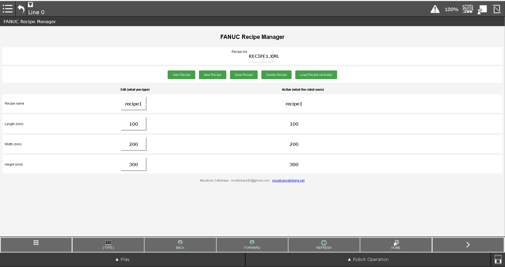
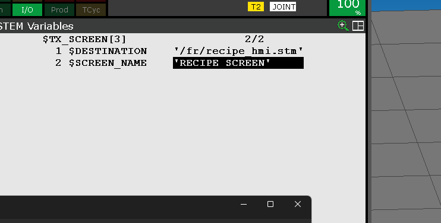
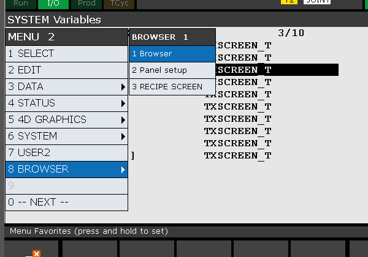

# FANUC Reçete Yöneticisi (KAREL + XML + Web)

🌐 [English](README.md) | **Türkçe** | [Deutsch](README.de.md)

**FANUC robot kontrolcüsünde reçete depolama ve yönetimi** için minimal, genel bir örnek.
Sadece dahili özellikler kullanılıyor: KAREL, kontrolcü üzerindeki XML dosyaları (FR:), register'lar ve Web Server sayfası (iPendant / tarayıcı).

Buradaki bir reçete sadece **isim + 3 sayıdan** oluşur (kutu uzunluğu, genişliği, yüksekliği) – istediğin kadar alan ekleyebilirsin.



*Örnek: `box_small.xml` seçili, boyutlar 300 × 200 × 150 mm. Sağda **Edit** register'ları (SR[2], R[11–13]) ile **Loaded** aktif register'lar (SR[3], R[1–3]) birlikte görünür.*

## Nasıl çalışır

```
 Web sayfası (recipe_hmi.stm)
   |  combo box  -> SR[1]   (seçili dosya, örn. "box_small.xml")
   |  edit kutuları -> SR[2], R[11..13]   (EDIT tarafı)
   v
 recipe_save.kl   SAVE / CREATE / DELETE   -> FR:\recipes\<isim>.xml
 recipe_load.kl   VIEW (-> edit register'ları)  /  LOAD (-> aktif register'lar SR[3], R[1..3])
```

| Buton | Program | Ne yapar |
|---|---|---|
| New Recipe | recipe_save | edit alanlarını temizler |
| Save Recipe | recipe_save | SR[2] + R[11..13] değerlerini XML dosyasına yazar |
| View Recipe | recipe_load | seçili XML'i edit alanlarına okur |
| Load Recipe | recipe_load | seçili XML'i robot programının kullandığı **aktif** register'lara okur |
| Delete Recipe | recipe_save | seçili XML dosyasını siler |

Edit / Aktif ayrımı sayesinde robot yüklü reçeteyle çalışmaya devam ederken diğer reçetelere bakabilir veya onları değiştirebilirsin.

## Register haritası

| Register | Anlamı |
|---|---|
| SR[1] | seçili dosya (combo box) |
| SR[2] / SR[3] | reçete adı – edit / aktif |
| R[11..13] | uzunluk, genişlik, yükseklik – edit |
| R[1..3] | uzunluk, genişlik, yükseklik – aktif (TP/KAREL programında bunları kullan) |

## Kurulum

Aşağıdaki ekran görüntüleri **CRX-25iA** iPendant'tan alınmıştır; menü yolları R-30iB / R-50iA ailesinde aynı mantıktadır.

### 1. KAREL'i etkinleştir

**Setup → KAREL Enbl** menüsünü aç ve **`$KAREL_ENB`** değerini **TRUE** (`1`) yap. Bu kapalıysa KAREL programları çalışmaz (değişiklikten sonra kontrolcüyü yeniden başlatman gerekebilir).

### 2. KAREL programlarını yükle

`recipe_save.kl` ve `recipe_load.kl` dosyalarını translate et (ROBOGUIDE veya `ktrans`) ve oluşan `.pc` dosyalarını kontrolcüye yükle.

### 3. Web sayfasını kopyala

`recipe_hmi.stm` dosyasını web sayfalarını tutacağın bellek konumuna kopyala. **FANUC web sayfaları `.stm` uzantılı olmak zorundadır.**

### 4. Sayfa yolunu `$TX_SCREEN` içinde tanımla

**Setup → TxScr Screen** menüsünü aç. `recipe_hmi.stm` dosyasının bulunduğu **cihaz** ve **dizin** bilgisini gir, **Save** ile kaydet. Yanlış olursa web sunucusu sayfayı bulamaz.



### 5. Reçete klasörünü oluştur

Kontrolcüde **`FR:\recipes\`** klasörünü oluştur. İstersen bu repodaki örnek **`box_small.xml`** dosyasını bu klasöre kopyala.

### 6. Web'den KAREL çağrısına izin ver

**Setup → Host Comm** (HTTP authentication) altında `.stm` sayfasının KAREL programlarını çağırabilmesi için gerekli erişimi aç (**KAREL CGI** / web'den program çağrısı — kontrolcü kılavuzuna göre ayarla).

### 7. Reçete sayfasını aç

**Pendant:** iPendant **Browser** menüsünden `$TX_SCREEN` içinde tanımladığın sayfa **adını** seç.

**PC tarayıcısı:**  
`http://<robot-ip>/<ayarlanan-dizin>/recipe_hmi.stm`

**View Recipe** / **Load Recipe** ile XML ile register'lar arasında veri taşınır; **Save Recipe** edit alanlarını `FR:\recipes\<isim>.xml` dosyasına yazar.



## Notlar
- Değerler integer (mm) olarak kaydedilir. Ondalık gerekiyorsa x10 veya x100 olarak sakla.
- `TPOUT[5] = FALSE` bir "robot meşgul" kilidi olarak kullanılıyor, böylece döngü ortasında reçete değiştirilemez – kendi sinyaline göre uyarla.
- XML, `XML_ADDTAG` / `XML_SCAN` / `XML_GETDATA` ile her seferinde tek bir tag okunarak işlenir.

## Yazar
**Muratcan Cetinkaya**
Mail: mcetinkaya40@gmail.com
Web: https://www.muratcancetinkaya.net
